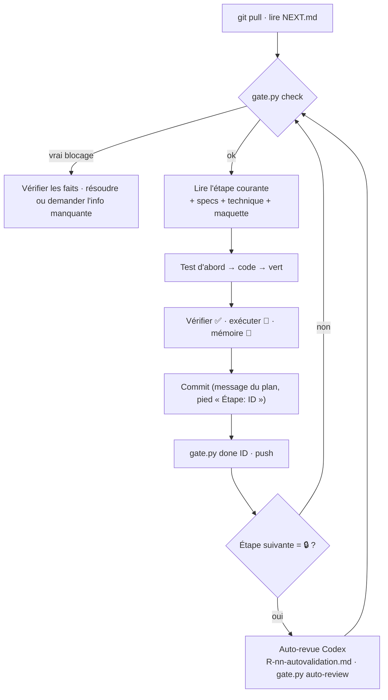

# Plan d'implémentation — InfraFlowSculptor v1

Ce dossier dit **dans quel ordre construire** et **comment vérifier** chaque étape. Il ne redéfinit ni le
fonctionnel ([`../specs/`](../specs/README.md)) ni l'architecture ([`../technique/`](../technique/README.md)) :
il s'y réfère par leurs identifiants.

| Vous cherchez… | Lisez |
|---|---|
| **Où on en est, quoi faire maintenant** | [`../../NEXT.md`](../../NEXT.md) — à la racine |
| Les étapes, dans l'ordre | Les fichiers numérotés ci-dessous |
| Pourquoi c'est construit ainsi | [`../technique/`](../technique/README.md) |
| À quoi ressemble chaque écran | [`../design/`](../design/README.md) |
| Ce qui a été fait, quand | [`JOURNAL.md`](JOURNAL.md) |
| Les auto-revues et leurs résultats | [`revues/`](revues/README.md) |
| Les recettes et leurs résultats | [`recettes/`](recettes/README.md) |

## Qui fait quoi

| Acteur | Rôle | Ne fait jamais |
|---|---|---|
| **Claude (Opus)** | A contribué aux décisions et documents historiques. | Aucun verdict de Claude ni d'un autre modèle n'est requis pour poursuivre. |
| **Luna (Codex)** | **Exécute et valide** le plan : tests d'abord, code, recettes, auto-revue, mémoire, commit et `NEXT.md`. | Prendre une décision de conception absente des documents ou ignorer un vrai blocage. |
| **Florian** | Fournit un choix de conception, une authentification ou un plafond de coût si ces éléments manquent réellement. | Exécuter les validations de routine que Codex peut faire lui-même. |

## Les phases

| Fichier | Phase | Étapes | Verrous | Détail |
|---|---|---|---|---|
| [`00-socle.md`](00-socle.md) | **S — Socle technique** : dépôt, backend depuis le template CQRS, Aspire et émulateurs, Angular depuis le template, design system, CI | `S-01` → `S-17` | `R-01` | Exécutable |
| [`01-preuves.md`](01-preuves.md) | **P — Preuves** P1–P5, P7–P9 ([04 § 7.2](../specs/04-perimetre-et-lots.md)) : sortie de référence du pilote écrite à la main et déployée sur Azure | `P-01` → `P-08` | `R-02`, `R-03` | Exécutable |
| [`02-jalon-0-pilote.md`](02-jalon-0-pilote.md) | **J0 — Pilote** ([04 § 2.0](../specs/04-perimetre-et-lots.md)) | `J0-01` → `J0-32` | `R-04` → `R-08` | Exécutable |
| [`03-jalon-1-tranche-verticale.md`](03-jalon-1-tranche-verticale.md) | **J1 — Tranche verticale** : projet de référence complet | `J1-01` → … | `R-09` → `R-12` | Découpé ; détaillé au verrou `R-08` |
| [`04-jalon-2-largeur.md`](04-jalon-2-largeur.md) | **J2 — Largeur** | `J2-01` → … | `R-13` → `R-15` | Découpé ; détaillé au verrou `R-12` |
| [`05-jalon-3-outillage.md`](05-jalon-3-outillage.md) | **J3 — Outillage** : MCP, graphe, recherche, import JSON, démonstration | `J3-01` → … | `R-16` → `R-18` | Découpé ; détaillé au verrou `R-15` |
| [`06-lots-2-a-4.md`](06-lots-2-a-4.md) | **Lots 2, 3, 4** | — | — | **Grossier, volontairement** |

**Pourquoi les jalons suivants ne sont pas encore détaillés au fichier près.** Une étape exécutable sans
décision cite des fichiers, des classes et des commandes qui n'existeront qu'après les étapes précédentes.
Les écrire trop tôt peut produire des étapes qui devront être réécrites. Chaque jalon est donc **découpé** dès
aujourd'hui (objectif, contenu, références, tests, recette), puis détaillé quand le code réel rend les choix vérifiables.
Luna ne commence pas une étape qui n'est pas exécutable : un fichier seulement découpé porte la ligne
`> **Niveau : découpé.**`, et `gate.py check` refuse (code 3) toute étape de ce fichier. Si les références ne suffisent pas
à retirer cette marque sans inventer une décision de conception, Luna demande à Florian le choix manquant.

## Anatomie d'une étape

```markdown
### J0-12 — Titre

| | |
|---|---|
| **Spécifications** | liens vers RG / UC / DEC |
| **Maquette** | preview/<Écran>.html — zones à implémenter / zones exclues (jalon ultérieur) |
| **Dépend de** | étapes |
| **Commit** | `type(portée): résumé` |

🎯 **Objectif.**  Ce que l'étape rend possible.
🔧 **À faire.**   Liste numérotée, fichiers et noms exacts.
✅ **Vérification automatique.**  Commandes et résultat attendu.
🧪 **Test de recette.**  Ce que Codex exécute et le résultat attendu.
🧠 **Mémoire.**  Fichiers de `.github/memory/` à mettre à jour.
📌 **Hors dépôt.**  État externe à consigner dans `NEXT.md` (Azure, Entra, Azure DevOps…), s'il y en a.
```

## Le cycle d'auto-validation

Skill : [`.agents/skills/executer-etape/SKILL.md`](../../.agents/skills/executer-etape/SKILL.md).



## Les verrous 🔒

Un verrou `R-nn` est un point de contrôle où **Luna relit et valide elle-même** tout ce qui a été fait depuis le verrou
précédent. Il ne suspend pas l'avancement pour attendre Claude, un autre modèle ou Florian.

1. **Luna** exécute et consigne les recettes du segment, relit les changements, relance les vérifications et écrit
   `docs/plan/revues/R-nn-autovalidation.md` selon le modèle dans [`revues/README.md`](revues/README.md).
2. `python tools/plan/gate.py auto-review R-nn` valide le checkpoint si le rapport contient le verdict, les tests, les
   recettes, les écarts et les contrôles de coût et de sécurité. Le crochet git et la CI ne bloquent pas les commits
   pendant cette auto-revue.
3. Luna poursuit sur la branche prévue et peut ouvrir, fusionner ou mettre à jour une pull request dans le périmètre de test
   autorisé. Toute contradiction, information d'accès manquante ou coût non chiffré reste un blocage explicite.
4. Si le prochain jalon est seulement découpé, le verrou ne permet pas d'inventer sa conception : Luna lit les références,
   puis demande à Florian le choix précis qui manque.

## Branches et pull requests

- Un **segment** = les étapes entre deux verrous. Une branche par segment : `impl/<segment>` (nom donné par
  le verrou précédent ; le premier est `impl/socle`), créée depuis `origin/main` à jour. **Exception** : quand le texte
  du verrou dit « même branche » (R-02), Luna continue sur la branche et la pull request du segment en cours.
- **Un commit par étape**, message du plan, en français, pied obligatoire :

  ```
  feat(moteur): calculer les noms Azure par gabarit

  Étape: J0-10
  ```
- Push après chaque étape (le travail sur plusieurs machines ne doit rien perdre).
- Au verrou : créer l'auto-revue. Une pull request `impl/<segment>` → `main` peut être créée et fusionnée par Codex dans le
  périmètre autorisé, après les contrôles requis par le dépôt.

## `NEXT.md`

`NEXT.md` est **court** : l'étape courante, son statut, la suivante, le verrou, l'état hors dépôt (📌), les
recettes impossibles avec les accès disponibles et les points ouverts pour Florian. Il ne contient ni l'historique (→ [`JOURNAL.md`](JOURNAL.md),
écrit par `gate.py`), ni le détail des étapes (→ ce dossier). S'il dépasse deux écrans, du détail y est
descendu qui appartenait ailleurs.

Les lignes du tableau « En un coup d'œil » sont lues et écrites par `gate.py` ; ne pas renommer leurs
libellés.

## Quand le plan ne suffit pas

Luna ne fabrique pas de décision de conception. Si une étape :
- contredit le code réel (nom de fichier, signature) → suivre le code réel **en restant fidèle à
  l'intention**, et noter l'écart pour la demande de revue ;
- contredit une spec, ou exige un choix non écrit (règle métier, sécurité, données personnelles, nouvelle
  dépendance, nouveau service Azure) → **s'arrêter** : statut `BLOQUE`, question écrite dans la section
  « Points ouverts » de `NEXT.md`. Florian tranche le choix ou fournit l'information nécessaire ; Luna vérifie la résolution,
  la consigne et lève le blocage avec `gate.py unblock`. Aucun avis de modèle externe n'est requis.
- dépend d'une version de paquet introuvable → règle de [DT-03](../technique/01-decisions.md#dt-03--versions-épinglées).

## Les recettes

Chaque étape a son 🧪 ; chaque segment a sa **recette** (enchaînement des 🧪 du segment, plus un parcours de
bout en bout) dans [`recettes/`](recettes/README.md). Codex exécute ces tests avec les utilisateurs de démonstration
([technique 05 § 3](../technique/05-execution-locale.md#3-utilisateurs-de-démonstration-royaume-keycloak-ifs)) et les accès disponibles.
Chaque test dit : prérequis, actions numérotées, résultat attendu, et quoi noter si ce n'est pas le cas. Si un accès ou une
information manque, Codex demande seulement cet élément à Florian ; il ne lui demande pas d'exécuter la recette.
